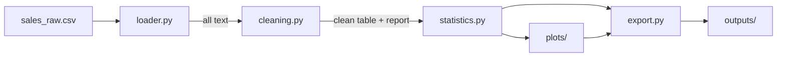

# 📊 Sales Data Analysis & Visualization

A complete **data analysis and visualization project in Python**, built with **pandas** and **matplotlib**. It takes a messy sales CSV file through the whole analysis workflow: **load → clean → describe → visualise → export**, and every step is a small, tested function.

It includes a realistic **messy sample dataset**, a **cleaning report**, descriptive statistics, **four chart types** (line chart, bar charts, histograms and a correlation heatmap), a one-command **pipeline** that exports everything (including a readable Markdown report), a **Jupyter notebook tutorial** and a detailed **analysis guide**.

---

## Table of Contents

1. [Features](#features)
2. [Quick Start](#quick-start)
3. [Project Structure](#project-structure)
4. [The Dataset](#the-dataset)
5. [How It Works](#how-it-works)
6. [Using the Code](#using-the-code)
7. [The Charts](#the-charts)
8. [Output Files](#output-files)
9. [Jupyter Notebook](#jupyter-notebook)
10. [Testing](#testing)
11. [Design Decisions](#design-decisions)
12. [Using Your Own Data](#using-your-own-data)
13. [Troubleshooting](#troubleshooting)
14. [Commit History Guide](#commit-history-guide)
15. [Roadmap](#roadmap)
16. [Contributing](#contributing)
17. [License](#license)

---

## Features

- **CSV loader** with clear error messages and a quick data health check
- **Messy sample data generator**: duplicates, missing values, prices stored as text, bad dates, odd spelling, impossible values and extreme outliers
- **Cleaning pipeline** made of small functions, with a **report** of every change
- **Descriptive statistics**: summary tables, group summaries, month-by-month revenue, correlations and headline metrics
- **Four chart types** with a consistent style: line chart (with moving average and peak label), bar charts (sorted, horizontal and grouped), histograms (single and grid) and a correlation heatmap
- **Export**: clean CSV, CSV tables, JSON metrics, a JSON cleaning report and a **Markdown report** with all charts
- **One command** to run everything: `python -m dataviz.pipeline`
- **Jupyter notebook tutorial** that explains each step
- **Detailed analysis guide** (`docs/analysis.md`)
- **Unit tests** for every module, including the charts and the notebook

---

## Quick Start

### Requirements

- Python 3.9 or newer
- pandas, NumPy and matplotlib (installed below)

### Windows (CMD)

```bat
git clone https://github.com/<your-username>/sales-data-analysis.git
cd sales-data-analysis

python -m venv .venv
.venv\Scripts\activate
pip install -r requirements-dev.txt

python -m dataviz.check_setup
python -m dataviz.sample_data
python -m dataviz.pipeline
```

### macOS / Linux

```bash
git clone https://github.com/<your-username>/sales-data-analysis.git
cd sales-data-analysis

python3 -m venv .venv
source .venv/bin/activate
pip install -r requirements-dev.txt

python -m dataviz.check_setup
python -m dataviz.sample_data
python -m dataviz.pipeline
```

Then open `outputs/report.md` and the charts in `outputs/figures/`.

> `requirements.txt` has only what the code needs. `requirements-dev.txt` adds pytest and JupyterLab.

---

## Project Structure

```
sales-data-analysis/
├── dataviz/                     # The Python package
│   ├── config.py                # Folders, column names, plot style
│   ├── check_setup.py           # Checks that pandas and matplotlib work
│   ├── sample_data.py           # Generates the messy sample CSV
│   ├── loader.py                # Loads the CSV
│   ├── cleaning.py              # Cleaning functions and the cleaning report
│   ├── statistics.py            # Descriptive statistics and summaries
│   ├── plots/
│   │   ├── common.py            # Shared chart helpers
│   │   ├── line.py              # Line chart
│   │   ├── bar.py               # Bar charts
│   │   ├── histogram.py         # Histograms
│   │   └── heatmap.py           # Correlation heatmap
│   ├── export.py                # Export to CSV, JSON and Markdown
│   └── pipeline.py              # Runs the whole analysis
├── data/raw/sales_raw.csv       # The messy sample data
├── notebooks/tutorial.ipynb     # Step-by-step tutorial
├── docs/analysis.md             # Detailed analysis guide
├── tests/                       # Unit tests for every module
├── requirements.txt
├── requirements-dev.txt
├── pytest.ini
└── README.md
```

---

## The Dataset

`data/raw/sales_raw.csv` contains about 1,200 orders (plus duplicates) from 2024 and 2025. It is **synthetic**, created by `python -m dataviz.sample_data`, and the same seed always creates the same file.

| Column            | Meaning                                         |
| ----------------- | ----------------------------------------------- |
| `order_id`        | Unique order number                             |
| `order_date`      | Day of the order                                |
| `region`          | North, South, East or West                      |
| `category`        | Electronics, Clothing, Home, Sports or Books    |
| `units`           | Items in the order                              |
| `unit_price`      | Price of one item                               |
| `discount`        | Fraction taken off (0.1 = 10%)                  |
| `customer_age`    | Age of the customer                             |
| `customer_rating` | Rating from 1 to 5                              |
| `marketing_spend` | Marketing money spent that day                  |
| `revenue`         | `units × unit_price × (1 − discount)`           |

### Problems added on purpose

| Problem                        | Example                       |
| ------------------------------ | ----------------------------- |
| Duplicate orders               | The same `order_id` twice     |
| Missing values                 | Empty age, rating, region, revenue |
| Numbers written as text        | `$1,234.50`                   |
| Inconsistent spelling          | `electronics`, `  NORTH `     |
| Broken dates                   | `not available`, `31/02/2024` |
| Impossible values              | Age `999`, units `-1`         |
| Extreme outliers               | A book priced at 20 times its normal price |

### Patterns built into the data

Seasonality (a big peak in November and December), price ranges that depend on the category, an age bell curve, and a few relationships between columns. They exist so you can check that the analysis finds what it should. See [`docs/analysis.md`](docs/analysis.md).

---

## How It Works



| Step | Module          | What happens                                                            |
| ---- | --------------- | ----------------------------------------------------------------------- |
| 1    | `loader.py`     | Reads the CSV (everything as text), checks the columns, gives clear errors |
| 2    | `cleaning.py`   | Fixes text, dates and numbers, removes duplicates and bad rows, fills gaps, removes outliers |
| 3    | `statistics.py` | Calculates summaries, group totals, monthly revenue and correlations    |
| 4    | `plots/`        | Draws the charts                                                        |
| 5    | `export.py`     | Saves the data, tables, metrics and the Markdown report                 |
| 6    | `pipeline.py`   | Runs all of the above                                                   |

### The cleaning pipeline

```
raw text → standardise text → parse dates (drop bad ones) → text to numbers
         → blank impossible values → drop duplicates → drop invalid orders
         → fill missing values → remove outliers (per category) → tidy types
```

It returns the clean table and a report:

```
Rows in:                    1,220
  invalid dates removed:    6
  duplicate orders removed: 20
  invalid rows removed:     8
  outliers removed:         5
Rows out:                   1,181
Impossible values blanked: customer_age (8)
Missing values filled:     customer_age (49), customer_rating (36), region (24), ...
```

*(The numbers above are an example. Yours will be printed when you run the pipeline.)*

---

## Using the Code

```python
from dataviz.loader import load_csv
from dataviz.cleaning import clean_sales_data
from dataviz.statistics import describe_numeric, revenue_by_month, summarize_by, correlation_matrix
from dataviz.plots.line import plot_monthly_revenue
from dataviz.plots.bar import plot_bar
from dataviz.plots.heatmap import plot_correlation_heatmap

raw = load_csv()                              # everything as text
clean, report = clean_sales_data(raw)         # a clean table and a report of what changed
print(report.summary())

print(describe_numeric(clean))                # statistics for every numeric column

monthly = revenue_by_month(clean)             # a Series: revenue per month
plot_monthly_revenue(monthly, save_path="monthly.png")

by_category = summarize_by(clean, "category")
plot_bar(by_category["sum"], title="Revenue by category", save_path="categories.png")

plot_correlation_heatmap(correlation_matrix(clean), save_path="heatmap.png")
```

Every chart function:

- returns the matplotlib `Figure`, so you can customise it further,
- accepts `save_path=` to write a PNG file,
- accepts `show=True` to open a window,
- accepts `close=True` to free the memory after saving (useful in loops).

### Command line

```bat
python -m dataviz.sample_data --rows 5000 --seed 7        # make a different dataset
python -m dataviz.pipeline                                # analyse the default file
python -m dataviz.pipeline --input my_sales.csv --output my_results
```

---

## The Charts

| Chart                                | Function                   | Shows                                                        |
| ------------------------------------ | -------------------------- | ------------------------------------------------------------ |
| Line chart                           | `plot_monthly_revenue`     | Revenue over time, with a moving average and the peak month  |
| Bar chart                            | `plot_bar`                 | Totals per group: sorted, labelled, vertical or horizontal   |
| Grouped bar chart                    | `plot_grouped_bar`         | Category × region side by side                               |
| Histogram                            | `plot_histogram`           | The spread of one column, with the mean and median           |
| Histogram grid                       | `plot_histogram_grid`      | Several distributions at once                                |
| Correlation heatmap                  | `plot_correlation_heatmap` | Which columns move together, from -1 to +1                   |

The pipeline saves seven charts to `outputs/figures/`. **How to read each chart, and what patterns to expect, is explained in [`docs/analysis.md`](docs/analysis.md).**

---

## Output Files

After `python -m dataviz.pipeline`, the `outputs/` folder contains:

```
outputs/
├── clean_sales.csv              # the cleaned data
├── summary.json                 # headline metrics
├── cleaning_report.json         # what the cleaning step changed
├── report.md                    # a readable report with all charts and tables
├── tables/
│   ├── numeric_summary.csv
│   ├── revenue_by_category.csv
│   ├── revenue_by_region.csv
│   ├── revenue_by_category_and_region.csv
│   ├── monthly_revenue.csv
│   ├── correlations.csv
│   └── strongest_correlations.csv
└── figures/
    ├── monthly_revenue.png
    ├── revenue_by_category.png
    ├── revenue_by_region.png
    ├── revenue_by_category_and_region.png
    ├── customer_age_histogram.png
    ├── distributions.png
    └── correlation_heatmap.png
```

The `outputs/` folder is listed in `.gitignore` because it can be recreated at any time. If you want the charts to show on GitHub, copy a few PNGs into a `docs/images/` folder and commit them.

---

## Jupyter Notebook

`notebooks/tutorial.ipynb` walks through the same workflow with explanations between the steps and a "Try it yourself" section at the end.

```bat
jupyter lab notebooks\tutorial.ipynb
```

Run the cells one by one with **Shift + Enter**. Create the sample data first with `python -m dataviz.sample_data`.

---

## Testing

```bat
python -m pytest -q
```

| Test file                    | What it checks                                                                 |
| ---------------------------- | ------------------------------------------------------------------------------ |
| `test_config.py`             | Folders, column groups and the plot style                                      |
| `test_sample_data.py`        | Realistic ranges, seasonality, repeatability, every kind of added problem      |
| `test_loader.py`             | Reading as text, helpful errors for missing, empty and wrong files, column names |
| `test_cleaning.py`           | Every cleaning step, the outlier rule and the whole pipeline with its report   |
| `test_statistics.py`         | Summaries, group totals, monthly revenue, correlations and key metrics, with exact expected values |
| `test_plot_line.py`          | Line data, moving average, peak label, saving files                            |
| `test_plot_bar.py`           | Sorting, labels, horizontal and grouped bars, empty data                       |
| `test_plot_histogram.py`     | Bin counts, that every value is counted once, mean and median lines, the grid  |
| `test_plot_heatmap.py`       | Colors match the values, fixed scale, annotations, labels, non-square input    |
| `test_export.py`             | CSV, JSON (numpy and dates), Markdown tables and the report                    |
| `test_pipeline.py`           | The whole pipeline end to end and the command line                             |
| `test_notebook.py`           | The notebook is valid, its code compiles and its imports exist                 |

### Testing charts

The tests draw charts to files (no windows open) and then look **inside** the figure: they check the data in the line, the height of every bar, the counts in the histogram bins and the values drawn in the heatmap. A chart that silently draws the wrong data would fail.

---

## Design Decisions

- **Load everything as text, convert deliberately.** One `$1,234.50` can silently ruin a numeric column. Loading as text lets the cleaning step handle each problem explicitly and report it.
- **Small functions that never change their input.** Each cleaning step takes a table and returns a new one, so every step can be tested and reused on its own.
- **A report with every cleaning run.** Cleaning changes the data, so the project always says how much it changed.
- **Outliers are judged per category.** A 900 dollar price is normal for Electronics and impossible for Books.
- **Median, not mean, for filling gaps.** It is not pulled around by extreme values.
- **Matplotlib only.** The project uses just pandas and matplotlib, so there is little to install and the charts are fully customisable.
- **Figures are returned.** Chart functions give back the `Figure`, so they work in scripts, notebooks and tests.
- **No Markdown library needed.** The report builder writes its own tables, so the project has no extra dependencies.

---

## Using Your Own Data

1. Put your CSV file anywhere and make sure it has the same columns as `data/raw/sales_raw.csv` (the names are case-insensitive and spaces are fine).
2. Run it:
   ```bat
   python -m dataviz.pipeline --input path\to\your_file.csv --output my_results
   ```
3. If the date format is not `YYYY-MM-DD`, pass `date_format` to `parse_dates` (use `date_format=None` to let pandas work out mixed formats), or call the cleaning functions one by one in a notebook.
4. If your columns are different, edit the column lists in `dataviz/config.py` and the matching rules in `dataviz/cleaning.py`.

---

## Troubleshooting

| Problem                                              | Fix                                                                           |
| ---------------------------------------------------- | ----------------------------------------------------------------------------- |
| `python` is not recognised                           | Install Python from python.org and tick **Add Python to PATH**, or use `py`   |
| `ModuleNotFoundError: No module named 'pandas'`      | Activate the virtual environment, then `pip install -r requirements-dev.txt`  |
| `ModuleNotFoundError: No module named 'dataviz'`     | Run commands from the project folder, with `python -m ...` as shown above     |
| `File not found: ...sales_raw.csv`                   | Create it with `python -m dataviz.sample_data`                                |
| Charts do not open in a window                       | The pipeline saves PNG files instead. Use `show=True` in your own code        |
| `Missing required columns: ...`                      | Your CSV needs the columns listed in [The Dataset](#the-dataset)              |
| `.venv\Scripts\activate` is blocked in PowerShell    | Use CMD, or run `Set-ExecutionPolicy -Scope CurrentUser RemoteSigned`         |
| The notebook test fails after you ran the notebook   | Use **Edit → Clear Outputs of All Cells** in Jupyter, then save               |

---

## Commit History Guide

| #  | Commit                                  | What it added                                                          |
| -- | --------------------------------------- | ---------------------------------------------------------------------- |
| 1  | Setup pandas and matplotlib             | Requirements, config, plot style, environment check                    |
| 2  | Create CSV data loader                  | Messy sample data generator, the CSV file and the loader               |
| 3  | Implement data cleaning functions       | Every cleaning step, the outlier rule and the cleaning report          |
| 4  | Add descriptive statistics calculation  | Summaries, group totals, monthly revenue, correlations, key metrics    |
| 5  | Create line chart visualization         | Shared chart helpers and the revenue line chart                        |
| 6  | Add bar chart implementation            | Sorted, horizontal and grouped bar charts                              |
| 7  | Create histogram visualization          | Single histograms and a grid                                           |
| 8  | Implement correlation heatmap           | The heatmap                                                            |
| 9  | Add data export functionality           | CSV, JSON and Markdown export, plus the end-to-end pipeline            |
| 10 | Create Jupyter notebook tutorial        | The step-by-step notebook, with a test that checks it                  |
| 11 | Add detailed analysis documentation     | `docs/analysis.md` and this README                                     |

---

## Roadmap

- [ ] Scatter plots and box plots
- [ ] Year-over-year comparison charts
- [ ] Interactive charts (Plotly) as an optional extra
- [ ] A command-line option to choose which charts to draw
- [ ] Excel export
- [ ] Support for other date formats through a configuration file
- [ ] A simple forecast of monthly revenue

---

## Contributing

1. Fork the repository
2. Create a branch: `git checkout -b feat/my-feature`
3. Make your changes and run `python -m pytest -q`
4. Commit with a clear message
5. Open a Pull Request

---

## License

This project does not include a license file. Unless the author adds one, all rights are reserved.